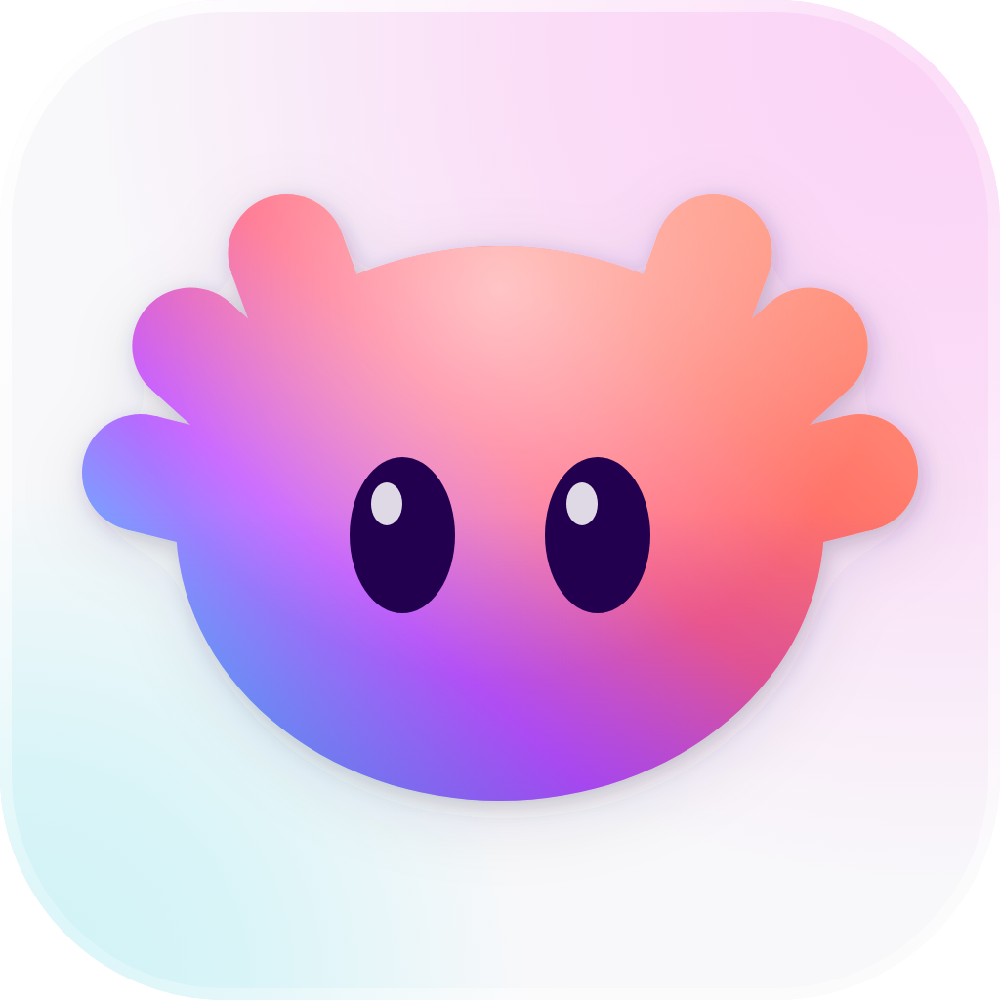

<p align="center">
  <picture>
    <source media="(prefers-color-scheme: dark)" srcset="assets/logo/axolotty-dark.png">
    
  </picture>
</p>

<h1 align="center">Axolotty</h1>

A terminal for working with coding agents, on macOS. Sessions are grouped by project in a sidebar that shows what each agent is doing (working, waiting for you, finished, failed), and agents can see and drive the terminal themselves.

Programs run in a small PTY holder (`axolotty-ptyd`) under a server (`axolottyd`), so closing the app, or updating it, leaves every shell and agent running. The app is one client of that server; the `axolotty` CLI and its MCP server are others.

## What it does

- **Your other Macs, as if they were this one.** Connect to Host (⇧⌘K) lists your Macs on the tailnet; Tailscale carries the link, and Axolotty speaks plaintext QUIC over it (Tailscale already encrypts), one stream per pane so a lost packet holds back only its own pane, falling back to TCP for a Mac from before QUIC or a path that drops UDP. A Mac without Axolotty is set up over ssh from here (Set Up Axolotty over SSH, which also updates an older one), with nothing to install by hand. A Mac that answers without Axolotty running is said "Not running", and its window offers that set-up rather than reconnecting for ever. On a far Mac:
  - keys show at once, before their echo: typing, ⌫, and ← → to fix a typo;
  - ⌘-click opens a path on that Mac in VS Code, Cursor or Windsurf over Remote-SSH;
  - a file dropped on its pane, or a screenshot pasted with ⌘V, goes to that Mac and its path there is pasted, so an agent there can read it;
  - what its programs open or copy for you comes here: a sign-in link (`open https://…`) opens in this Mac's browser, and `pbcopy` or OSC 52 (an agent's `/copy`, vim, tmux) lands on this Mac's clipboard;
  - a link to its own `localhost` (a dev server at `localhost:5173`, a sign-in waiting on `127.0.0.1:8085`) is carried to it first, ⌘-clicked or opened, so the page opens here at the same port; at another one only when this Mac already has that port;
  - the band shows its branch and changes, and its notices say which Mac.
- **Agent status from the agent itself.** Claude Code reports over OSC 7501, and any other program can too. Rows, the band, the Dock badge, toasts and notifications all follow it. A notification goes away as soon as you've seen its pane.
- **Find who needs you.** Go to Session (⌘J) lists sessions as needs-you, then finished, then working. Next waiting agent is ⇧⌘U.
- **Worktree sessions.** ⌥⌘T, or "New Worktree…" on a project's "+", starts an agent on its own branch in `<repo>/.worktrees/<branch>`. "Remove Worktree…" deletes the folder and keeps the branch.
- **Reopen a closed session** (⇧⌘T) in its folder; a Claude Code session resumes the very conversation it had. Subagents at work show beside the agent's timer.
- **Shell integration** for zsh, bash and fish:
  - prompt jumps (⌘↑ ⌘↓);
  - a pane's ended bar, where ↩ restarts the program in place;
  - a command of 10 s or more that ends while you look elsewhere marks its row done or failed, like an agent.
- **On screen:**
  - ⌘-click links and `file:line`;
  - Find (⌘F);
  - Secure Keyboard Entry while a program reads a password.
- **What agents produced:** the diff chip in the band, and Open in Editor (⌥⌘O) to read it.
- **Look:** Axolotty Night and Day, following the system or fixed. The terminal starts in Geist Mono (the Nerd Fonts Mono build, bundled, so prompt and TUI icons draw on any Mac), and takes any installed monospaced font.

## Agents drive Axolotty

Claude Code started from Axolotty gets its tools via `--mcp-config "$AXOLOTTY_MCP"`, a file Axolotty owns. The agent's own config is never written. The same operations are available from any pane:

```
axolotty ls                                  # workspaces, sessions, panes, status
axolotty new --cwd ~/code/app --worktree fix/login -- claude
axolotty send --pane 1a2b "Run the tests and fix what fails"
axolotty wait --pane 1a2b --for done
axolotty wait --pane 1a2b,3c4d --for done    # whichever finishes first
axolotty capture --pane 1a2b                 # the pane's screen as text
axolotty attach --pane 1a2b                  # drive the pane from this terminal (ssh); ^] detaches
axolotty mcp                                 # the same, as MCP tools over stdio
```

`send` pastes the text, then presses Enter on its own, which is how an agent's TUI takes a prompt. It won't type into a pane whose agent is waiting for its person unless you pass `--force`. That way an agent never answers another agent's permission prompt by accident.

## Build

Requirements: macOS 27 or later (iOS 27 for the iPhone and iPad app) and the Swift toolchain named in `Package.swift`. `Vendor/GhosttyVT.xcframework` comes from `scripts/build-ghostty-vt.sh`, which needs Zig, and only has to run when the pinned commit changes. `Vendor/AxQuic.xcframework`, the QUIC link, comes from `scripts/build-axquic.sh`, which needs Rust (rustup) and rebuilds only when `Rust/axquic` changes.

```
swift build                                  # everything, debug
swift test
AXOLOTTY_HOME=/tmp/axdev swift run AxolottyDev   # the app against a scratch server
scripts/package-app.sh                       # dist/Axolotty.app (release, ad hoc signed)
```

Set `SIGN_IDENTITY` to sign `dist/Axolotty.app` with a Developer ID instead. The app registers the server as a LaunchAgent on first launch; `AXOLOTTY_HOME` keeps a development server and its state separate from your real one.

Design notes live in `.research/design-system.md`.

## Third-party

The QUIC link (`Rust/axquic`) runs n0's noq with Slopty's patches (`Rust/axquic/vendor/*/SLOPTY.md`) under MIT or Apache-2.0, and ports Slopty's null crypto provider and transport tuning (MIT). Its simulated network (`Rust/axquic/tests/shape`) is Slopty's `slopty-shape` (MIT).


Geist Mono © 2023 Vercel, patched by Nerd Fonts v3.5.1, under the SIL Open Font License 1.1: `Sources/AxMacUI/Resources/Fonts/LICENSE-GeistMono.txt`, with the icon sets' licences in `README-NerdFonts.md` beside it.
